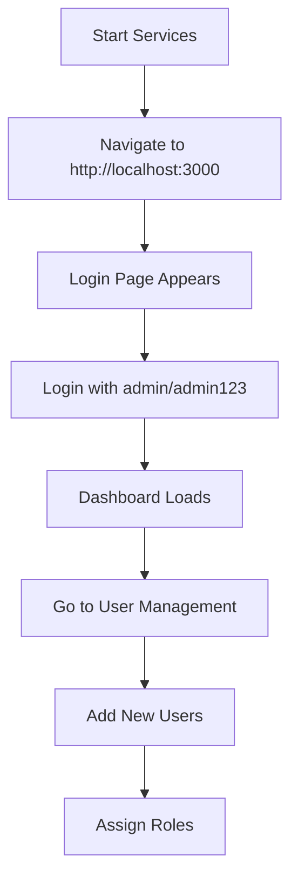
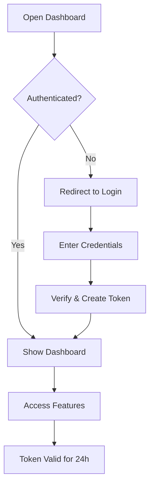

# 🔐 Authentication System Guide

## Overview

CloudOps Command Center now includes a complete authentication system with:

- ✅ **Login Page** - Secure user authentication
- ✅ **JWT Token-based Auth** - Industry-standard token authentication
- ✅ **Role-based Access Control** - Admin and User roles
- ✅ **User Management** - Admin can add, edit, and delete users
- ✅ **Protected Routes** - All pages require authentication
- ✅ **Password Management** - Change and reset passwords

---

## 🚀 Quick Start

### 1. Start the Platform

```bash
docker-compose up -d
```

### 2. Access the Login Page

Open your browser and navigate to:
```
http://localhost:3000
```

You'll be automatically redirected to the login page.

### 3. Login with Default Admin

**Username:** `admin`  
**Password:** `admin123`

> ⚠️ **Important:** Change the default admin password after first login!

---

## 🎯 Features

### Login Page
- Modern, responsive design with gradient background
- Real-time validation
- Error messages for failed login
- Loading states
- Default credentials displayed for easy first-time access

### User Management (Admin Only)
- View all users in a table
- Add new users with role assignment
- Edit existing users (email, name, role, status)
- Delete users (except admin)
- Reset user passwords
- Active/Inactive status toggle

### Protected Routes
- All dashboard pages require authentication
- Automatic redirect to login if not authenticated
- Token verification on page load
- Automatic token refresh

### User Profile
- Displayed in sidebar footer
- Shows user name, role, and email
- Quick logout functionality
- Dropdown menu for user actions

---

## 👥 User Roles

### Admin
- Full access to all features
- Can access User Management page
- Can add, edit, and delete users
- Can reset any user's password
- Cannot delete the default admin user

### User
- Access to all dashboard features
- Cannot access User Management
- Can change their own password
- Cannot manage other users

---

## 🔧 API Endpoints

### Authentication Endpoints

| Method | Endpoint | Description | Auth Required |
|--------|----------|-------------|---------------|
| POST | `/auth/login` | User login | ❌ |
| POST | `/auth/register` | Register new user | ✅ Admin |
| GET | `/auth/me` | Get current user info | ✅ |
| POST | `/auth/verify` | Verify JWT token | ✅ |
| POST | `/auth/change-password` | Change password | ✅ |

### User Management Endpoints (Admin Only)

| Method | Endpoint | Description |
|--------|----------|-------------|
| GET | `/users` | List all users |
| GET | `/users/{username}` | Get user by username |
| PUT | `/users/{username}` | Update user |
| DELETE | `/users/{username}` | Delete user |
| POST | `/users/{username}/reset-password` | Reset user password |

---

## 🔐 Security Features

### Password Security
- Passwords hashed with SHA256
- No plain-text password storage
- Password validation required

### Token Security
- JWT tokens with expiration (24 hours)
- Secure token generation
- Token verification on every request
- Automatic logout on token expiration

### Session Security
- Tokens stored in localStorage
- Automatic cleanup on logout
- Protection against XSS attacks
- HTTP-only cookies support (can be enabled)

### Route Protection
- All routes protected by default
- Automatic redirect for unauthenticated users
- Role-based access control for admin pages
- Token validation on every route change

---

## 📚 Usage Examples

### Adding a New User (Admin)

1. Login as admin
2. Navigate to "Users" page (visible only to admins)
3. Click "+ Add User" button
4. Fill in the form:
   - **Username:** johndoe
   - **Email:** john@example.com
   - **Password:** SecurePass123
   - **Full Name:** John Doe
   - **Role:** user or admin
5. Click "Add User"

### Editing a User (Admin)

1. Go to Users page
2. Click the ✏️ edit icon next to the user
3. Modify user details
4. Toggle Active/Inactive status if needed
5. Click "Update User"

### Resetting a Password (Admin)

1. Go to Users page
2. Click the 🔑 key icon next to the user
3. Enter new password in the prompt
4. Confirm

### Changing Your Own Password

1. Click on your profile in the sidebar
2. Navigate to Settings (future feature)
3. Enter old password and new password
4. Click "Change Password"

Alternatively, use the API:

```bash
curl -X POST http://localhost:8007/auth/change-password \
  -H "Authorization: Bearer YOUR_TOKEN" \
  -H "Content-Type: application/json" \
  -d '{
    "old_password": "admin123",
    "new_password": "NewSecurePass456"
  }'
```

---

## 🛠️ Technical Implementation

### Frontend Components

```
frontend/src/
├── context/
│   └── AuthContext.jsx          # Authentication context provider
├── pages/
│   ├── Login.jsx                # Login page
│   └── UserManagement.jsx       # User management page (admin)
└── styles/
    ├── Login.css                # Login page styles
    └── App.css                  # Updated with auth styles
```

### Backend Service

```
services/auth-service/
├── main.py                      # FastAPI authentication service
├── requirements.txt             # Python dependencies
└── Dockerfile                   # Container image
```

### Key Technologies

- **Frontend:**
  - React Context API for state management
  - React Router for protected routes
  - Axios for HTTP requests
  - LocalStorage for token persistence

- **Backend:**
  - FastAPI for REST API
  - PyJWT for token generation/verification
  - Redis for user data storage
  - Pydantic for data validation

---

## 🧪 Testing Authentication

### Test Login

```bash
curl -X POST http://localhost:8007/auth/login \
  -H "Content-Type: application/json" \
  -d '{
    "username": "admin",
    "password": "admin123"
  }'
```

**Expected Response:**
```json
{
  "access_token": "eyJhbGciOiJIUzI1NiIsInR5cCI6IkpXVCJ9...",
  "token_type": "bearer",
  "user": {
    "id": "xxx",
    "username": "admin",
    "email": "admin@cloudops.local",
    "full_name": "Administrator",
    "role": "admin",
    "is_active": true,
    "created_at": "2026-08-28T...",
    "last_login": "2026-08-28T..."
  }
}
```

### Test Protected Endpoint

```bash
# Get token first
TOKEN=$(curl -s -X POST http://localhost:8007/auth/login \
  -H "Content-Type: application/json" \
  -d '{"username":"admin","password":"admin123"}' | jq -r '.access_token')

# Use token to access protected endpoint
curl -X GET http://localhost:8007/auth/me \
  -H "Authorization: Bearer $TOKEN"
```

### Test User Creation (Admin)

```bash
curl -X POST http://localhost:8007/auth/register \
  -H "Authorization: Bearer $TOKEN" \
  -H "Content-Type: application/json" \
  -d '{
    "username": "johndoe",
    "email": "john@example.com",
    "password": "SecurePass123",
    "full_name": "John Doe",
    "role": "user"
  }'
```

---

## 🔄 User Workflow

### First-Time Setup



### Daily Usage



---

## 🚨 Troubleshooting

### Problem: "Invalid username or password"

**Solution:**
- Verify you're using the correct credentials
- Default admin: `admin` / `admin123`
- Check if user account is active

### Problem: "Token has expired"

**Solution:**
- Login again to get a new token
- Tokens expire after 24 hours
- System will automatically redirect to login

### Problem: "User account is inactive"

**Solution:**
- Contact an admin to reactivate your account
- Admin can toggle user status in User Management page

### Problem: Can't access User Management page

**Solution:**
- This page is only available to admin users
- Login with an admin account
- Check your role in the user profile dropdown

### Problem: Frontend can't connect to auth service

**Solution:**
```bash
# Check if auth service is running
docker ps | grep auth-service

# Check auth service logs
docker logs cloudops-auth-service

# Verify auth service is healthy
curl http://localhost:8007/health
```

---

## 📊 Database Schema

Users are stored in Redis with the following structure:

```json
{
  "id": "unique_id",
  "username": "admin",
  "email": "admin@cloudops.local",
  "password": "hashed_password",
  "full_name": "Administrator",
  "role": "admin",
  "is_active": true,
  "created_at": "2026-08-28T10:00:00",
  "last_login": "2026-08-28T12:30:00"
}
```

**Redis Keys:**
- `user:{username}` - User data
- `userid:{id}` - Username lookup by ID
- `users` - Set of all usernames

---

## 🔒 Best Practices

### For Admins

1. ✅ Change default admin password immediately
2. ✅ Create unique accounts for each team member
3. ✅ Assign appropriate roles (least privilege principle)
4. ✅ Regularly review user accounts
5. ✅ Disable inactive user accounts
6. ✅ Use strong passwords for all accounts

### For Users

1. ✅ Use strong, unique passwords
2. ✅ Don't share your credentials
3. ✅ Logout when leaving your workstation
4. ✅ Report suspicious activity to admins
5. ✅ Change your password periodically

### For Developers

1. ✅ Never commit tokens or passwords
2. ✅ Use environment variables for secrets
3. ✅ Implement token refresh logic
4. ✅ Validate all user inputs
5. ✅ Log authentication events
6. ✅ Implement rate limiting (future)

---

## 🎯 Next Steps

### Immediate (Implemented ✅)
- [x] Login page
- [x] JWT authentication
- [x] Protected routes
- [x] User management
- [x] Role-based access control

### Future Enhancements (Not Yet Implemented)
- [ ] Password strength requirements
- [ ] Email verification
- [ ] Two-factor authentication (2FA)
- [ ] Password reset via email
- [ ] Session management dashboard
- [ ] Audit logs for user actions
- [ ] OAuth integration (Google, GitHub)
- [ ] API key management
- [ ] Rate limiting
- [ ] LDAP/Active Directory integration

---

## 📞 Support

### Get Help

**API Documentation:**
- FastAPI Docs: http://localhost:8007/docs
- ReDoc: http://localhost:8007/redoc

**Check Service Status:**
```bash
./test-services.sh
```

**View Logs:**
```bash
# Auth service logs
docker logs -f cloudops-auth-service

# All services
docker-compose logs -f
```

---

## 🎉 Summary

Your CloudOps Command Center now has enterprise-grade authentication with:

✅ Secure login system  
✅ JWT token authentication  
✅ Role-based access control  
✅ User management interface  
✅ Protected routes  
✅ Password security  

**Default Admin Login:**
- Username: `admin`
- Password: `admin123`

**Access the platform:**
```
http://localhost:3000
```

**Start exploring!** 🚀
